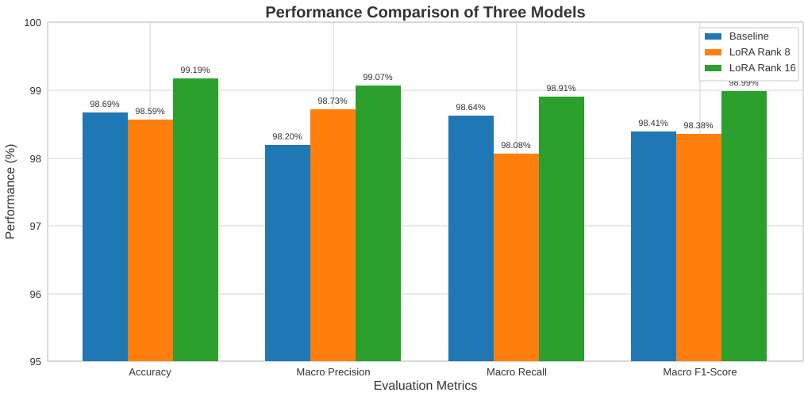
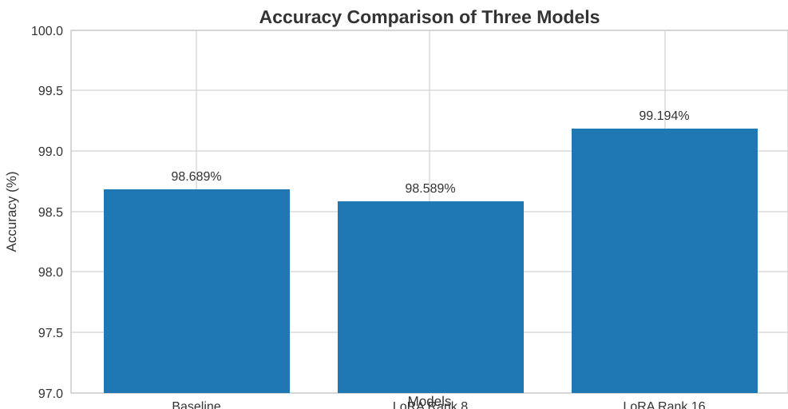
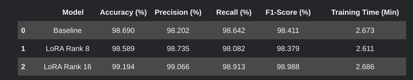

# Latent Diffusion for Domain-Specific Texture Synthesis with LoRA

This repository explores fine-tuning Stable Diffusion for a narrow image domain using Low-Rank Adaptation (LoRA), and evaluates whether synthetic images can help a downstream image-classification task. The repository description mentions plant diseases and fabrics as possible domain examples; the available repository artifacts do not identify which dataset/domain was actually used.

> **Reproducibility note:** Dataset source, class names, sample counts, generated-image count, and train/validation/test split details are not documented in the README or otherwise verifiable from the notebook metadata currently available. They are intentionally not guessed here. Please consult the notebook outputs and dataset configuration used for the experiment before relying on or reproducing those values.

## Contents

| Path | Description |
|---|---|
| [`GenAI-Diffusion vs Diffusion+lora(8).ipynb`](GenAI-Diffusion%20vs%20Diffusion%2Blora(8).ipynb) | Notebook named for the diffusion/LoRA Rank 8 comparison. |
| [`GenAI-lora(16).ipynb`](GenAI-lora(16).ipynb) | Notebook named for the LoRA Rank 16 experiment. |
| [`results/performance_comparison.svg`](results/performance_comparison.svg) | Comparison of model accuracy, macro precision, macro recall, and macro F1-score. |
| [`results/accuracy_comparison.svg`](results/accuracy_comparison.svg) | Accuracy comparison chart. |
| [`results/model_metrics_table.svg`](results/model_metrics_table.svg) | Metrics and training-time summary. |

## Project goal

The project investigates a data-augmentation workflow:

1. Start with real images from a domain-specific dataset.
2. Adapt a Stable Diffusion model with LoRA at different ranks (the repository includes notebook names for ranks 8 and 16).
3. Generate synthetic domain images and use them in an image-classification experiment.
4. Compare classification performance and training time with a baseline.

The repository currently contains notebooks and result graphics; it does not include a separately documented, versioned dataset or a standalone implementation package. For the precise sequence of cells, prompts, hyperparameters, and data-processing steps, see the notebooks.

## Dataset and generated images

The following details are **not stated in the repository information available for this README** and should be filled in from the experiment notebook/configuration rather than inferred:

| Item | Recorded value |
|---|---|
| Dataset name and source/license | Not documented here |
| Domain and class labels | Not documented here |
| Number of original images, overall and per class | Not documented here |
| Image format, dimensions, and preprocessing | Not documented here |
| Number of synthetic images generated, overall and per class | Not documented here |
| Generation prompts, seeds, and filtering/deduplication method | Not documented here |
| Whether synthetic images were used for training only or other splits | Not documented here |

Do not treat the number of images in the notebook or a displayed sample grid as the total generated-image count unless the generation loop/output confirms that count.

## Dataset split and leakage considerations

The split proportions, random seed, stratification strategy, and exact counts for training, validation, and test sets are not documented in the available repository summary. Therefore, this README does not claim a particular split (such as 80/20 or 70/15/15).

For a reliable synthetic-data evaluation, split the original real dataset before augmentation; keep validation and test images real and held out; and ensure generated variants of an image do not cross split boundaries. Report the split method, seed, per-class counts, and whether the baseline and LoRA experiments used exactly the same held-out test set.

## Reported evaluation results

The result figures report the following metrics:

| Model | Accuracy (%) | Precision (%) | Recall (%) | F1-score (%) | Training time (min) |
|---|---:|---:|---:|---:|---:|
| Baseline | 98.690 | 98.202 | 98.642 | 98.411 | 2.673 |
| LoRA Rank 8 | 98.589 | 98.735 | 98.082 | 98.379 | 2.611 |
| LoRA Rank 16 | 99.194 | 99.066 | 98.913 | 98.988 | 2.686 |

The chart labels use “Macro Precision,” “Macro Recall,” and “Macro F1-Score”; the summary table shortens these labels. Values are reproduced from the committed result graphics. The repository does not currently document enough evaluation details to establish the dataset split, class averaging implementation, hardware, or timing methodology, so these results should be interpreted in that context.

### Figures

**Performance across reported metrics**

**Accuracy comparison**

**Metrics and training-time table**

## Notebooks

Open the notebooks in Jupyter or a compatible notebook environment. The notebook metadata identifies a Python 3 kernel (version 3.13.16). The repository does not currently include a dependency lockfile or a verified environment specification, so package versions and any required accelerator/runtime should be taken from the notebook cells and the environment in which the reported results were produced.

1. Open `GenAI-Diffusion vs Diffusion+lora(8).ipynb` for the baseline/Rank 8 experiment.
2. Open `GenAI-lora(16).ipynb` for the Rank 16 experiment.
3. Run cells in order after configuring access to the dataset and any model credentials required by the notebook.
4. Record the runtime, package versions, dataset split, generation parameters, and random seeds when reproducing results.

The notebook files may refer to local, mounted, or hosted dataset paths; those paths are environment-specific and must be configured for your setup. Do not commit credentials, private data, or access tokens.

## Reproducibility checklist

Before publishing or comparing a rerun, document:

- Dataset name, source URL, license, class list, and exact image counts.
- Preprocessing and image resolution.
- Train/validation/test split proportions and counts, split seed, and stratification method.
- Synthetic-image count per class, prompts, generation parameters, seeds, and selection criteria.
- How synthetic images were incorporated into training and confirmation that evaluation data remained held out.
- Model/checkpoint identifiers, LoRA rank and training configuration, classifier configuration, package versions, hardware, and timing procedure.
- Metric definitions and whether precision, recall, and F1 are macro-, micro-, or weighted-averaged.

## Limitations

- The dataset and generated-image inventory are not included or described in the README artifacts.
- The reported metrics do not, on their own, establish that synthetic data caused an improvement; fair attribution requires comparable training conditions and a fixed held-out test set.
- No dependency file or complete command-line workflow is currently provided.

## License and data use

No license or dataset-use terms are specified in the repository details reviewed for this README. Check the repository and dataset owners' terms before redistribution or commercial use; do not assume that the model, notebook, generated images, or source dataset share the same license.
